<!-- v:hero -->
<picture>
  <source media="(max-width: 600px) and (prefers-color-scheme: dark)" srcset="assets/voyage-narrow-dark.svg">
  <source media="(max-width: 600px)" srcset="assets/voyage-narrow-light.svg">
  <source media="(prefers-color-scheme: dark)" srcset="assets/voyage-wide-dark.svg">
  
</picture>
<!-- /v:hero -->

We build [USDCtoFiat](https://usdctofiat.xyz), a USDC cash-out app, plus Peerlytics market data and open-source DeFi agent tools. Started by [Andrew Wilkinson](https://andrewwilkinson.io) in London.

## Products

- **[USDCtoFiat](https://usdctofiat.xyz)**: cash out USDC on Base to a bank or payment app. **<!-- v:fig:usdctofiat-deposited -->$610k+<!-- /v:fig:usdctofiat-deposited -->** deposited through the app, as of <!-- v:asof:usdctofiat-deposited -->Nov 2026<!-- /v:asof:usdctofiat-deposited -->
- **[Peerlytics](https://peerlytics.xyz)**: rate and liquidity data for USDCtoFiat, with a Peer protocol explorer. **<!-- v:fig:peerlytics-indexed -->$36M+<!-- /v:fig:peerlytics-indexed -->** in protocol deposits indexed, as of <!-- v:asof:peerlytics-indexed -->Nov 2026<!-- /v:asof:peerlytics-indexed -->
- **[tokensto.cash](https://tokensto.cash)**: sell spare LLM API capacity for USDC, then cash out through USDCtoFiat. **<!-- v:fig:tokenstocash-tokens -->814M+<!-- /v:fig:tokenstocash-tokens -->** tokens sold, as of <!-- v:asof:tokenstocash-tokens -->Oct 2026<!-- /v:asof:tokenstocash-tokens -->

Figures are floors from the [published record](https://andrewwilkinson.io/metrics.json). App deposits are lifetime funding, not current balances.

## Open source

Andrew builds and maintains these three projects. Pick the one that fits how you work.

- **[HyperGrok](https://github.com/galleonlabs/hypergrok-trading-desk#start)**: a Hyperliquid trading desk for AI agents. Research, risk and review, with execution only on tickets you approve. Runs in Grok Bot, Claude Code, Cursor, Codex, Gemini CLI and Grok Build. · **<!-- v:stars:galleonlabs/hypergrok-trading-desk -->603<!-- /v:stars:galleonlabs/hypergrok-trading-desk --> stars**
- **[Boomkin](https://github.com/galleonlabs/boomkin#get-started)**: keep your question, source data and report together in a local Hermes research desk.
- **[crypto-defi-skills](https://github.com/galleonlabs/crypto-defi-skills#install-only-what-you-need)**: give your existing agent a specific task, such as checking an Aave position or comparing swap quotes.

[Sponsor Andrew on GitHub](https://github.com/sponsors/ADWilkinson) to support release testing and updates when protocols change.

## Latest ships

<!-- v:log -->
- `22 Nov 2026` [Boomkin 0.13.9 and 0.14.0](<https://github.com/galleonlabs/boomkin/releases/tag/v0.14.0>)
- `22 Nov 2026` [crypto-defi-skills: 3 packs updated](<https://github.com/galleonlabs/crypto-defi-skills/releases/tag/galleon-defi-data-skills%400.8.0>)
- `22 Nov 2026` [HyperGrok 1.9.1 and 1.10.0](<https://github.com/galleonlabs/hypergrok-trading-desk/releases/tag/v1.10.0>)
- `18 Nov 2026` [Boomkin 0.13.8](<https://github.com/galleonlabs/boomkin/releases/tag/v0.13.8>)
- `17 Nov 2026` [Boomkin 0.13.6 and 0.13.7](<https://github.com/galleonlabs/boomkin/releases/tag/v0.13.7>)
<!-- /v:log -->

## Peer protocol data

Use Peerlytics' [weekly Peer volume and fill reports](https://peerlytics.xyz/explorer/reports), [weekly CSV](https://peerlytics.xyz/explorer/reports/weekly.csv), and [realised USDC seller-rate evidence](https://peerlytics.xyz/explorer/seller-rates) for read-only research on Base. The [source and citation guide](peerlytics-data.md) explains coverage, methodology, downloads and how these figures differ from advertised rates and other volume sources.

## Contributing and licence

These projects are open source and MIT licensed. Keep the copyright and license notice when reusing their work. See [Contributing](https://github.com/galleonlabs/.github/blob/main/CONTRIBUTING.md) for checks and contribution guidance.

[gm@galleonlabs.io](mailto:gm@galleonlabs.io) · [andrewwilkinson.io](https://andrewwilkinson.io)

The drawing above is regenerated daily by [`scripts/voyage.ts`](../scripts/voyage.ts) from public records: one mark per release or milestone, one lane per project, commit days as streaks in the wake.
